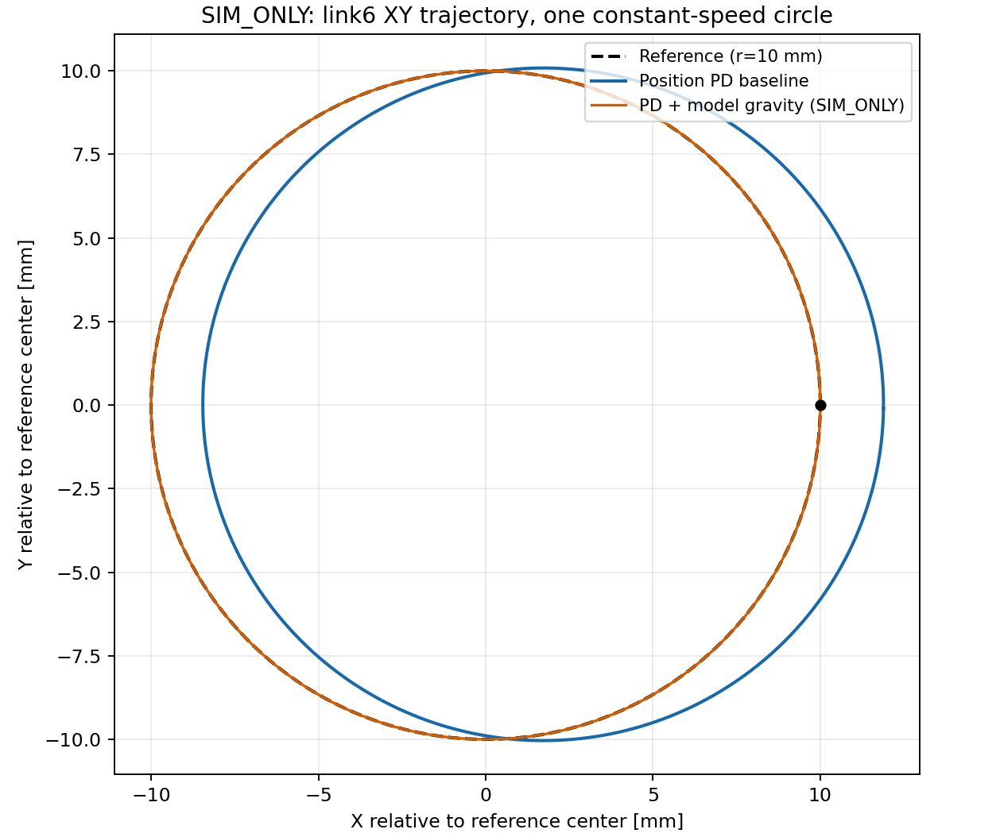
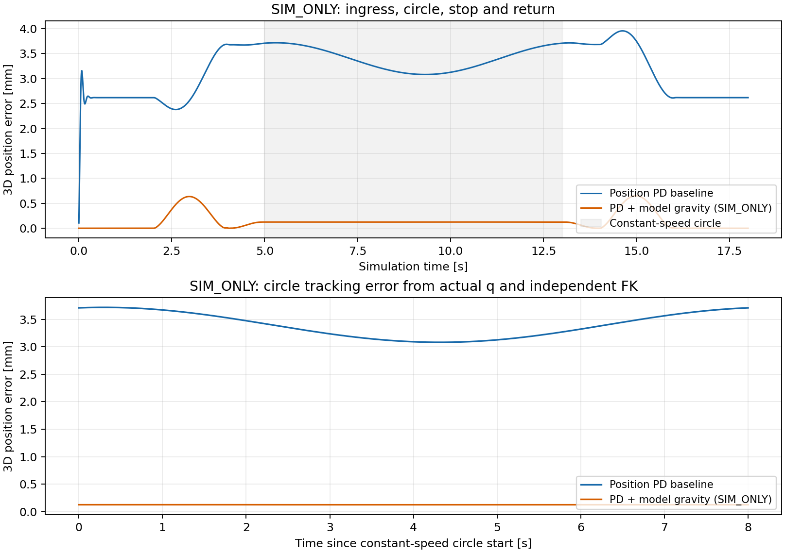

# B1-S1：无策略空中圆轨迹传统控制基线

日期：2026-11-13（KST）；输入基线：`a8f1ba99d903ed8f7e3284c0eb63aa6ca29b6199`。

**结论：PASS（本阶段限定的 SIM_ONLY 基线）。** 碰撞正/负例、运行时 cooked hull 关系、离线全路径筛查、传统 IK+PD 恒速圆一圈及独立 FK 评估完成。普通 PD 原始结果保留，另做同轨迹的模型重力前馈对照。该 PASS 表示规定仿真实验完成及诊断门限通过，不表示末端误差达到了某项硬件规格或实机门禁放行。

## 环境、输入和控制

复用 Factory `factory-g01` 隔离 venv、Isaac Sim 4.5.0、Isaac Lab Git tag v2.1.1（commit `90b79bb2d44feb8d833f260f2bf37da3487180ba`，extension 0.41.3），实际 runtime 记录 Python 3.10.12、PyTorch 2.7.0+cu128、NumPy 1.26.4。PhysX在CPU上运行，dt=1/240 s；headless仍初始化RTX 3070图形栈。没有升级软件或改变 Factory 源码；110个既有环境/启动文件指纹复核未变。版本、脚本hash及模型hash在[运行证据](data/B1_S1_RUNTIME_EVIDENCE.json)和[基线摘要](data/B1_S1_BASELINE_SUMMARY.json)中。

模型仍为 B0-R1A 的私有 USD；URDF SHA-256=`78c1b35c65fe747876c19c06c3ca3492d22aeac4416c536f585da494ef6842ae`，4个USD层hash运行前后与既有记录一致。单台固定基座机械臂，无末端工具、桌面、任务物体、RL环境或策略网络；参考点为 base_link 下的 link6。

普通 PD 逐步执行 `τ=clip(Kp(q_ref−q)−Kd*dq,±20)`，零速度目标与S0一致。Kp=200 Nm/rad、Kd=4 Nm·s/rad、armature=0.02 kg·m²、摩擦0、速度上限0.5 rad/s、effort上限20 Nm、solver 8/4、contact offset 1 mm，均为 **SIM_ONLY**。所有裁剪前/后命令和 PhysX 关节投影力矩分别记录，不称作真实电机传感力矩。

每步通过名称确认 `joint1…joint6` 对应关系，读取实际q、dq；以同一实际q执行独立URDF FK得到link6位置，用它计算跟踪误差，同时与Isaac actor/link pose交叉核对。[执行源码](../../scripts/run_circle_trajectory.py#L318)没有拿控制目标代替反馈或使用COM坐标。实际时间取 `SimulationContext.current_time` 与 `current_time_step_index`，同时保留参考/命令时间并检查步数和时钟一致。

## 指标

圆心、半径10 mm、周期8 s及过渡见 [轨迹报告](B1_S1_CIRCLE_TRAJECTORY.md)。以下误差用**全部1,921个恒速圆采样**计算3D欧氏距离，未混入18秒全序列的保持/进入误差；完整逐阶段指标另存摘要。

| 指标 | 普通PD基线 | PD+模型重力前馈对照（SIM_ONLY） |
|---|---:|---:|
| 末端位置RMSE | 3.407317 mm | 0.124385 mm |
| 位置误差P95 | 3.714172 mm | 0.124860 mm |
| 最大位置误差 | 3.718178 mm | 0.124904 mm |
| 姿态误差RMSE | 0.0111909 rad | 8.999e-6 rad |
| 实际角度展开跨度 | 6.2831895 rad | 6.2831909 rad |
| 恒速圆执行时长 | 8 s | 8 s |
| 全序列时长 / 物理步 | 18 s / 4,320 | 18 s / 4,320 |
| 全序列最大关节速度 | 0.281083 rad/s | 0.281093 rad/s |
| 全序列最大关节加速度 | 21.2028 rad/s² | 0.433241 rad/s² |
| 恒速圆最大速度 / 加速度 | 0.104216 rad/s / 0.081135 rad/s² | 0.104216 / 0.081135 |
| 全序列最大命令力矩 | 1.470602 Nm | 1.444675 Nm |
| 力矩饱和比例 | 0 | 0 |
| 碰撞/模型位置越限/非有限状态 | 0 | 0 |

普通PD圆周实际平均半径约10.1912 mm，半径RMSE约1.2296 mm；重力前馈对照约10.0012 mm、0.00120 mm。实际角度展开与参考均覆盖一圈，不能据“完成一圈”忽略绝对位置偏差。

普通PD基线的关节误差：

| 关节 | 圆周RMSE rad | 圆周最大绝对误差 rad |
|---|---:|---:|
| joint1 | 0.00031695 | 0.00046456 |
| joint2 | 0.00666100 | 0.00760182 |
| joint3 | 0.00449371 | 0.00522335 |
| joint4 | 0.00104816 | 0.00158104 |
| joint5 | 0.00013019 | 0.00021408 |
| joint6 | 0.00109663 | 0.00165005 |

joint2/joint3最大；平均末端实际−参考偏差约 `[+1.7177,+0.0244,−2.9313] mm`。对照只在同一显式PD输入增加 `root_physx_view.get_gravity_compensation_forces()` 当前模型前馈，统一经原有20 Nm裁剪；未关闭重力或改变位置目标。圆周RMSE下降约96.35%，平均偏置接近0，支持“模型重力静差是主要误差来源”的判断。剩余动态误差仍存在，未继续优化参数。此对照依赖未经实物标定的CAD质量与模型动力学，不能部署到实机；见[对照证据](data/B1_S1_GRAVITY_COMPARISON.json)。

最大21.2028 rad/s²出现在普通PD初始保持的重力启动暂态，圆周期间仅0.081135 rad/s²；没有把启动暂态隐藏在圆周指标中。正式实验的速度/加速度诊断停止门限为0.55 rad/s、40 rad/s²，后者在初步暂态观测后明确设为SIM_ONLY；它不是硬件安全阈值。最大目标相邻步幅0.00117186 rad，实际相邻步幅0.00117123 rad。没有观测到持续发散、饱和或限位报警。

动态FK与Isaac actor pose最大差：普通PD `2.633e-7 m / 7.281e-7 rad`，前馈对照 `2.209e-7 m / 7.499e-7 rad`。这是模型内部数值一致性，不是实机定位精度。





## 复现命令与证据

下列变量展开到实际使用的既有Factory启动器和本地私有输入；完整stdout/stderr按同名日志保存在 `runs/`，不提交厂商资产。

```bash
B1_FACTORY=/home/ubuntu2004/Documents/Codex/2026-10-23/the-github-repository-has-now-been
B1_URDF=/tmp/student_ros_b0_audit.sYOXbS/student_ros/src/episode1_urdf_1113/urdf/episode1_urdf_1113.urdf
B1_LAUNCHER="$B1_FACTORY/outputs/isaac-factory-repro/scripts/run_sim.sh"

python3 scripts/generate_circle_trajectory.py --urdf "$B1_URDF" --output runs/b1_s1/plan_005
env FACTORY_VENV="$B1_FACTORY/work/envs/factory-g01" PYTHONDONTWRITEBYTECODE=1 timeout --signal=TERM --kill-after=10s 180s "$B1_LAUNCHER" scripts/run_circle_trajectory.py --urdf "$B1_URDF" --usd model_assets/local/b0_r1_usd/robot.usd --trajectory runs/b1_s1/plan_005/trajectory.jsonl --output runs/b1_s1/trial_005 --headless --device cpu
env FACTORY_VENV="$B1_FACTORY/work/envs/factory-g01" PYTHONDONTWRITEBYTECODE=1 timeout --signal=TERM --kill-after=10s 180s "$B1_LAUNCHER" scripts/run_circle_trajectory.py --urdf "$B1_URDF" --usd model_assets/local/b0_r1_usd/robot.usd --trajectory runs/b1_s1/plan_005/trajectory.jsonl --output runs/b1_s1/trial_006_gravity --gravity-compensation --headless --device cpu
python3 scripts/evaluate_circle_trajectory.py --baseline runs/b1_s1/trial_005 --gravity-control runs/b1_s1/trial_006_gravity --output docs/reports/data --figures docs/reports/figures
```

碰撞独立试验使用同一 `env…timeout… "$B1_LAUNCHER"` 前缀，执行 `scripts/validate_collision_positive.py`；立方体不传机器人参数，机器人用 `--robot-usd model_assets/local/b0_r1_usd/robot.usd --robot-urdf "$B1_URDF" --robot-case positive|negative`，分别输出 `_011` 和 `_009`目录。精确参数、版本、失败及警告索引见[运行证据](data/B1_S1_RUNTIME_EVIDENCE.json)。

正式PD/前馈运行各保存输入配置、参考hash、runtime metadata、cooked统计、4,320行240 Hz状态、summary/result；退出码均为0，且检查新产生的 `B1_S1_RESULT=PASS` 和 `B1_S1_TIMELINE_STOPPED`，不以退出码单独判定。公开[基线10 Hz摘录](data/B1_S1_BASELINE_10HZ.jsonl)和[前馈摘录](data/B1_S1_GRAVITY_10HZ.jsonl)额外保留阶段首尾。私有 cooked 顶点和完整日志留在忽略目录。

初次 `trial_001` 在AppLauncher前导入SciPy，混用了venv与Kit依赖，导致扩展导入错误；且当时全局接触回调未启用，所以不作为正式结果。后续改为CPU预筛查独立子进程、Kit启动后再导入几何依赖。正式日志没有 `[Error]`；保留OmniHub不可达、缺少crash reporter/rendering_modes、MaterialX和旧API弃用警告，不声称完整视觉渲染已验证。CPU单元测试31项通过；标准库模式31项中12项可选依赖测试跳过。原始仿真失败日志和早期规划目录保留；初期离线拒绝原因来自本次交互输出，未另存原始stdout，已在运行证据中明确标注。

## 下一门与学习验收

已具备**限定圆任务的B2纯仿真环境构建输入**：模型、参考/过渡、命名、基础位置接口、碰撞诊断、FK及传统误差基线都有可复查证据。本次未创建RL环境、未运行PPO、未连接实机；不自动进入B2。真实型号、零位/方向、TCP、安装、负载、真实速度/加速度/力矩与SDK连续控制语义仍UNKNOWN，B0实机门禁继续BLOCKED。

1. 为什么必须在 `SimulationContext` 创建之后启用接触处理，S0零回调为什么不足以证明无碰撞？
2. 为什么q=0附近的奇异性不阻断本次关节空间进入，却会影响直接从那里执行固定姿态笛卡尔圆的IK？
3. 重力前馈对照改变了哪一项控制输入，为什么它能解释PD偏置，却不能证明真实机器人也有0.124 mm精度？

研究者尚未作答，学习验收保持 NOT_STARTED。
