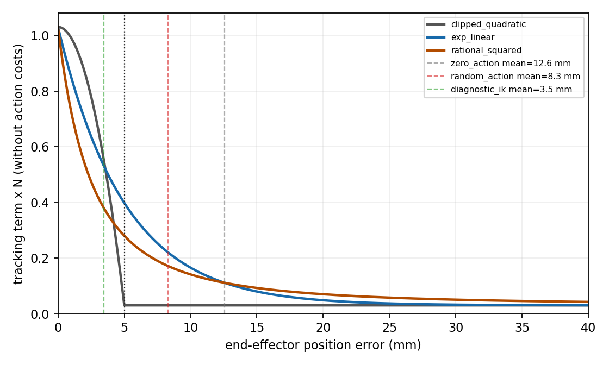

# B2-S1：奖励可学习性审查

日期：2026-11-14（KST）；输入基线：`700187dc76fee20d6905f2fab5892d628feea27a`。结论为 **PARTIAL（SIM_ONLY，奖励候选已实现并通过 CPU 契约测试；尚未以该候选启动 PPO）**。

本审查保留 B2-S0 的 clipped quadratic 奖励和历史运行证据。B2-S0 的配置文件未改写，缺省模式仍是旧公式；B2-S1 使用单独的 `configs/b2_s1_reward_sim_only.json` 选择 `exp_linear`。两者都不是实机 SDK 或安全参数。

## 1. 输入数据与截断比例

分析输入是 B2-S0 最终普通 PD 运行的 3,780 条有效位置误差记录中的三个动作组（完整原始日志在被忽略的 `runs/` 目录，公开汇总见 [数据](data/B2_S1_REWARD_AUDIT.json)）。统计只使用包含 `position_error_m` 的连续控制步，不把故障记录补成零误差。

| 输入 | 样本数 | `e≤5 mm` | `e>5 mm` | 平均误差 | P95 | 最大误差 |
|---|---:|---:|---:|---:|---:|---:|
| 零动作 | 1,260 | 16.90% | 83.10% | 12.570 mm | 21.835 mm | 22.195 mm |
| 随机动作 | 1,260 | 26.98% | 73.02% | 8.303 mm | 16.239 mm | 29.015 mm |
| 传统 IK 诊断输入 | 1,260 | 100.00% | 0.00% | 3.464 mm | 3.711 mm | 4.641 mm |

因此，零动作和随机输入的大部分时间位于旧奖励的 5 mm 截断区，而 IK 诊断全程位于截断区内。这个结果只说明奖励输入覆盖，不说明 PPO 会收敛。

## 2. 旧奖励的问题

B2-S0 旧公式（`src/robot_rl_sim2real/circle_rl.py` 的 `clipped_quadratic` 缺省模式）为：

```text
E       = min((e / 0.005)^2, 1)
r_pos   = (0.03 + 1 - E) / 630
r_act   = -0.005 * mean(a^2) / 630
r_delta = -0.005 * mean((a-a_prev)^2) / 630
```

当 `e≥5 mm` 时，`r_pos=0.03/630=4.7619e-5`，误差从 5 mm 增加到 40 mm 不再改变位置项。图中的灰色曲线和数值由纯 CPU 脚本 [audit_reward_learning.py](../../scripts/audit_reward_learning.py) 生成：



在误差 10 mm 时，旧位置项仍为 `0.03/630`；因此策略在 5 mm 外无法从位置项区分“稍微接近”和“明显偏离”。动作惩罚的上界为：幅度 `-0.005/630`、变化 `-0.020/630`，合计 `-0.025/630`。它小于位置项正下限 `0.03/630`，所以单步总奖励下界仍为 `0.005/630=7.9365e-6`。这避免了通过提前终止来跳过未来负奖励，但不能修复截断造成的学习信号不足。

零动作没有额外动作成本，不能仅凭其正回报判断“保持不动”是好策略：完整零动作轨迹的误差大部分超出 5 mm，旧位置回报主要是正下限。位置误差从 10 mm 降到 5 mm 时，任何动作代价上限仅约 `0.025/630`，只要动作能带来位置项改善就应有净收益；旧公式的问题是改善没有连续表达。

B2-S0 实际逐步分量的均值（每步已经除以 630）如下，说明动作项比位置项小约三个数量级，但在位置项达到截断下限时仍会影响局部排序：

| 输入 | `r_pos` 均值 | `r_act` 均值 | `r_delta` 均值 | `r_total` 均值 |
|---|---:|---:|---:|---:|
| 零动作 | `1.4976e-4` | `0` | `0` | `1.4976e-4` |
| 随机动作 | `2.8485e-4` | `-8.2173e-7` | `-4.1356e-7` | `2.8362e-4` |
| 传统 IK 诊断 | `8.6849e-4` | `-4.1253e-7` | `-1.0198e-9` | `8.6807e-4` |

## 3. 候选比较与选择

三种都以 `s=5 mm`、`floor=0.03`、`N=630` 为参数，表中是未扣动作项的 `N*r_pos`：

| 误差 | 旧 clipped quadratic | `exp_linear` | `rational_squared` |
|---:|---:|---:|---:|
| 0 mm | 1.0300 | 1.0300 | 1.0300 |
| 2.5 mm | 0.7800 | 0.6365 | 0.4744 |
| 5 mm | 0.0300 | 0.3979 | 0.2800 |
| 10 mm | 0.0300 | 0.1653 | 0.1411 |
| 20 mm | 0.0300 | 0.0483 | 0.0700 |
| 40 mm | 0.0300 | 0.03034 | 0.04235 |

候选定义为：

```text
r_pos = (0.03 + exp(-e / 0.005)) / 630
```

选择 `exp_linear` 的理由是公式最短、始终连续且单调、在 5 mm 以上仍能区分误差，并保留相同正下限与动作代价。它没有加入姿态、碰撞或额外塑形项；碰撞、越限、非有限状态继续由独立终止逻辑处理。候选实现是 `reward_components(..., cfg)` 的 `tracking_reward_mode="exp_linear"` 分支，旧模式在缺省时仍为 `clipped_quadratic`。

候选配置：[`configs/b2_s1_reward_sim_only.json`](../../configs/b2_s1_reward_sim_only.json)。该文件只改变奖励模式，所有其余时间、动作、终止和控制参数沿用 B2-S0，并标记 `SIM_ONLY`。B2-S0 旧配置和历史结果保持不变。

## 4. 测试与限制

新增 CPU 单元测试覆盖：

- `exp_linear` 的解析值与单调性；
- 5 mm 以上仍有区分能力；
- 候选每步奖励仍为正；
- 未知奖励模式拒绝；
- 旧模式在 10 mm 和 20 mm 仍保持历史截断行为。

运行 `python3 -m unittest discover -s tests -q`：**43 项通过**（其中新增奖励候选测试通过；另含 B2-S1 冻结成功判据测试）。曲线和汇总可用以下纯 CPU 命令重建：

```bash
python3 scripts/audit_reward_learning.py \
  --transitions runs/b2_s0/full_pd_005/transitions.jsonl \
  --output-json docs/reports/data/B2_S1_REWARD_AUDIT.json \
  --output-figure docs/reports/figures/B2_S1_REWARD_CURVES.png
```

本报告未将候选回报曲线误称为训练结果。候选已在 Isaac Lab 中完成普通 PD、`pd_gravity`、零动作、随机动作和诊断输入的完整 2 环境回归；逐步分量、终止和截断证据见[训练准备报告](B2_S1_TRAINING_READINESS.md)。候选没有消除普通 PD 的重力静差，也没有证明实机可用。
